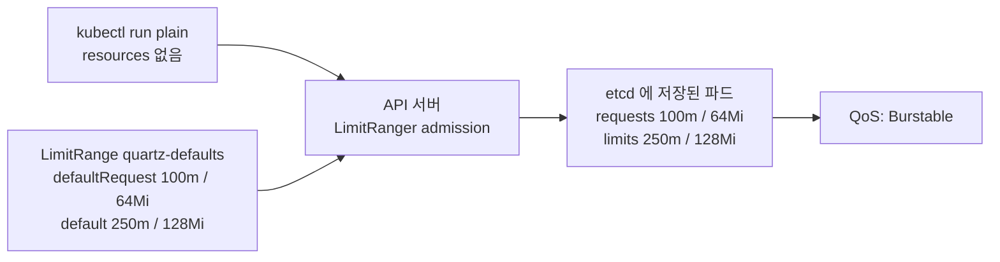

# q11 — Apply default resources with a LimitRange · 풀이

← 문제: **[question.md](question.md)**

## 문제 (해석)

**원문**

> Developers in namespace `quartz` often forget to set resources. Give every new container sensible
> defaults.
>
> 1. Create a LimitRange named `quartz-defaults` in namespace `quartz` for type `Container` with
>    default requests `cpu: 100m`, `memory: 64Mi` and default limits `cpu: 250m`, `memory: 128Mi`.
> 2. Create a pod named `plain` in namespace `quartz` with image `nginx:1.27-alpine` and **no**
>    `resources` section.
> 3. Write the `resources` of pod `plain`'s container, as stored by the API server, in JSON to
>    `/opt/course/e11/resources.json`.

**해석**

`quartz` 네임스페이스의 개발자들이 자원 설정을 자주 빠뜨린다. 새로 만들어지는 모든 컨테이너에 적절한
기본값을 준다.

1. `quartz` 네임스페이스에 type `Container` 로 LimitRange `quartz-defaults` 를 만든다. 기본 requests 는
   `cpu: 100m`, `memory: 64Mi`, 기본 limits 는 `cpu: 250m`, `memory: 128Mi` 이다.
2. `quartz` 네임스페이스에 이미지 `nginx:1.27-alpine` 으로, `resources` 항목이 **없는** 파드 `plain` 을
   만든다.
3. API 서버에 저장된 파드 `plain` 컨테이너의 `resources` 를 JSON 으로 `/opt/course/e11/resources.json`
   에 쓴다.

## 모범 풀이

**1) LimitRange — 명령형이 없으므로 YAML**

```yaml
# /tmp/e11-lr.yaml
apiVersion: v1
kind: LimitRange
metadata:
  name: quartz-defaults
  namespace: quartz
spec:
  limits:
  - type: Container
    defaultRequest:          # requests 기본값
      cpu: 100m
      memory: 64Mi
    default:                 # limits 기본값 (이름이 default 다)
      cpu: 250m
      memory: 128Mi
```

```bash
kubectl apply -f /tmp/e11-lr.yaml
kubectl -n quartz describe limitrange quartz-defaults
# Type       Resource  Min  Max  Default Request  Default Limit  Max Limit/Request Ratio
# Container  cpu       -    -    100m             250m           -
# Container  memory    -    -    64Mi             128Mi          -
```

필드 이름이 함정입니다. **`default` 가 limits**, **`defaultRequest` 가 requests** 입니다. `defaultLimit`
같은 필드는 없습니다. `defaultRequest` 를 빼고 `default` 만 주면 requests 도 limits 와 같은 값으로
채워집니다.

**2) resources 없는 파드**

```bash
kubectl -n quartz run plain --image=nginx:1.27-alpine
```

**3) 저장된 값 기록**

```bash
kubectl -n quartz get pod plain -o jsonpath='{.spec.containers[0].resources}' > /opt/course/e11/resources.json
cat /opt/course/e11/resources.json; echo
# {"limits":{"cpu":"250m","memory":"128Mi"},"requests":{"cpu":"100m","memory":"64Mi"}}
kubectl -n quartz get pod plain -o yaml | grep limitrange
# kubernetes.io/limit-ranger: 'LimitRanger plugin set: cpu, memory request for container plain; cpu, memory limit for container plain'
```

기본값은 **파드를 만드는 순간** LimitRanger admission 플러그인이 채워 넣습니다. 그래서 순서가 중요합니다.
LimitRange 보다 먼저 만든 파드에는 아무것도 적용되지 않습니다. 이미 있는 파드에 적용하려면 다시 만들어야
합니다.

### 그림 — admission 단계에서 채워지는 기본값



1. 사용자가 보낸 파드에는 `resources` 가 비어 있습니다.
2. API 서버의 LimitRanger 가 같은 네임스페이스의 LimitRange 를 읽어 비어 있는 requests/limits 를 채웁니다.
3. 채워진 값이 그대로 저장되므로 `get pod -o jsonpath` 로 확인할 수 있고, requests < limits 라서 QoS 는 Burstable 입니다.

## 검증

```bash
kubectl -n quartz get limitrange
# NAME              CREATED AT
# quartz-defaults   2026-10-24T01:00:00Z
cat /opt/course/e11/resources.json; echo
# {"limits":{"cpu":"250m","memory":"128Mi"},"requests":{"cpu":"100m","memory":"64Mi"}}
kubectl -n quartz get pod plain -o jsonpath='{.status.qosClass}{"\n"}'     # Burstable
```

## 오답 원인 / 배운 점

- **왜 틀렸나**:
- **기억할 것**: LimitRange 의 `default` = limits, `defaultRequest` = requests. 파드 생성 시점에만 적용된다.
- **헷갈리는 지점**: ResourceQuota 는 네임스페이스 **총량**을 제한하고 LimitRange 는 컨테이너 **하나당** 기본값·최소·최대를 정합니다. requests 를 요구하는 ResourceQuota 가 있는 네임스페이스에서는 LimitRange 기본값이 있어야 resources 없는 파드가 거부되지 않습니다. v1.35 GA 의 in-place resize 로 바꾼 값도 LimitRange 의 min/max 검사를 받습니다.

## 참고 문서

- 검색어: `limit range`, `configure default memory request and limit`
- https://kubernetes.io/docs/concepts/policy/limit-range/
- https://kubernetes.io/docs/tasks/administer-cluster/manage-resources/memory-default-namespace/

---

[↑ 문항 목록](../README.md) · [← 문제로](question.md) · [다음 문제 q12 →](../q12_rbac_serviceaccount_pods/question.md)
