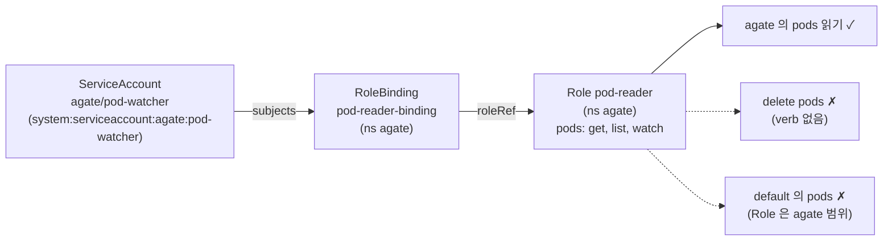

# q12 — Let a ServiceAccount list pods · 풀이

← 문제: **[question.md](question.md)**

## 문제 (해석)

**원문**

> A monitoring tool runs as ServiceAccount `pod-watcher` in namespace `agate` and must be able to
> read pods there, and nothing more.
>
> 1. Create a Role named `pod-reader` in namespace `agate` that allows the verbs `get`, `list` and
>    `watch` on `pods`.
> 2. Create a RoleBinding named `pod-reader-binding` in namespace `agate` that grants this Role to
>    ServiceAccount `pod-watcher`.
> 3. Using `kubectl auth can-i` while impersonating the ServiceAccount, check these three
>    questions and write the three answers (`yes`/`no`), one per line in this order, to
>    `/opt/course/e12/can-i.txt`:
>    list pods in `agate`; delete pods in `agate`; list pods in namespace `default`.

**해석**

모니터링 도구가 `agate` 네임스페이스의 ServiceAccount `pod-watcher` 로 실행되며, 그 네임스페이스의 파드를
읽을 수만 있어야 하고 그 이상은 안 된다.

1. `agate` 네임스페이스에 `pods` 에 대해 verb `get`, `list`, `watch` 를 허용하는 Role `pod-reader` 를
   만든다.
2. 이 Role 을 ServiceAccount `pod-watcher` 에 부여하는 RoleBinding `pod-reader-binding` 을 `agate`
   네임스페이스에 만든다.
3. ServiceAccount 로 가장(impersonate)한 `kubectl auth can-i` 로 다음 세 가지를 확인하고, 세 답
   (`yes`/`no`)을 이 순서대로 한 줄에 하나씩 `/opt/course/e12/can-i.txt` 에 쓴다:
   `agate` 에서 pods list; `agate` 에서 pods delete; 네임스페이스 `default` 에서 pods list.

## 모범 풀이

**1) Role**

```bash
kubectl -n agate create role pod-reader --verb=get,list,watch --resource=pods
```

**2) RoleBinding**

```bash
kubectl -n agate create rolebinding pod-reader-binding \
  --role=pod-reader --serviceaccount=agate:pod-watcher
```

`--serviceaccount` 의 형식은 `<네임스페이스>:<이름>` 입니다. 이름만 쓰면 에러가 납니다. ServiceAccount 는
`--user` 가 아니라 `--serviceaccount` 로 넣어야 subject `kind: ServiceAccount` 가 됩니다.

**3) 가장해서 확인**

```bash
SA=system:serviceaccount:agate:pod-watcher
kubectl auth can-i list pods -n agate --as=$SA          # yes
kubectl auth can-i delete pods -n agate --as=$SA        # no
kubectl auth can-i list pods -n default --as=$SA        # no
{ kubectl auth can-i list pods -n agate --as=$SA
  kubectl auth can-i delete pods -n agate --as=$SA
  kubectl auth can-i list pods -n default --as=$SA; } > /opt/course/e12/can-i.txt
```

`can-i` 는 답이 `no` 이면 종료 코드 1 을 돌려줍니다. 그래서 `&&` 로 이어 붙이면 두 번째 줄에서 멈춥니다.
위처럼 `{ ...; }` 로 묶거나 `;` 로 잇습니다. 이 SA 의 권한 전체는
`kubectl auth can-i --list -n agate --as=$SA` 로 볼 수 있습니다.

### 그림 — subject → binding → role



1. RoleBinding 의 `subjects` 에 SA 가 들어가고, `roleRef` 가 같은 네임스페이스의 Role 을 가리킵니다.
2. Role 은 네임스페이스 범위라서 `agate` 안의 pods 에만 효력이 있습니다. 다른 네임스페이스에서는 `no` 입니다.
3. RBAC 은 허용만 있는 모델이라 Role 에 없는 verb(`delete`)는 자동으로 거부됩니다.

## 검증

```bash
cat /opt/course/e12/can-i.txt
# yes
# no
# no
kubectl -n agate get role pod-reader -o jsonpath='{.rules}{"\n"}'
# [{"apiGroups":[""],"resources":["pods"],"verbs":["get","list","watch"]}]
kubectl -n agate get rolebinding pod-reader-binding -o wide
# NAME                 ROLE              AGE   USERS   GROUPS   SERVICEACCOUNTS
# pod-reader-binding   Role/pod-reader   1m                     agate/pod-watcher
```

## 오답 원인 / 배운 점

- **왜 틀렸나**:
- **기억할 것**: SA 가장은 `--as=system:serviceaccount:<ns>:<sa>`, 바인딩은 `--serviceaccount=<ns>:<sa>`.
- **헷갈리는 지점**: `--as=pod-watcher` 처럼 이름만 주면 같은 이름의 **사용자**로 검사해 늘 `no` 가 나옵니다. v1.24 부터 SA 토큰 Secret 이 자동으로 만들어지지 않으므로, 토큰이 필요하면 `kubectl create token pod-watcher -n agate --duration=1h` 로 발급합니다.

## 참고 문서

- 검색어: `using rbac authorization`, `kubectl auth can-i`
- https://kubernetes.io/docs/reference/access-authn-authz/rbac/
- https://kubernetes.io/docs/reference/kubectl/generated/kubectl_auth/kubectl_auth_can-i/

---

[↑ 문항 목록](../README.md) · [← 문제로](question.md) · [다음 문제 q13 →](../q13_pod_security_restricted/question.md)
