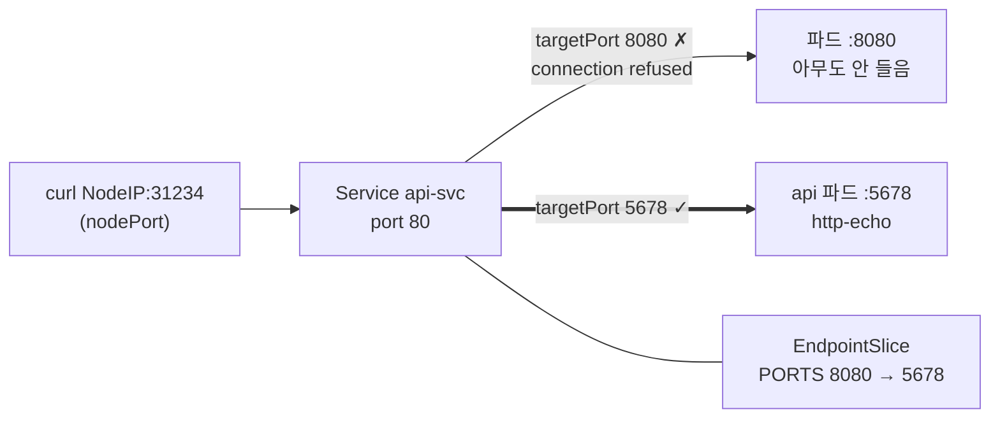

# q15 — Repair a NodePort Service with a wrong targetPort · 풀이

← 문제: **[question.md](question.md)**

## 문제 (해석)

**원문**

> Deployment `api` in namespace `jasper` is healthy, but requests to its NodePort Service
> `api-svc` from outside the cluster fail.
>
> 1. Find which port the `api` containers actually listen on and write the number to
>    `/opt/course/e15/port.txt`.
> 2. Fix Service `api-svc` so that it forwards traffic to that port. Do not change the Deployment,
>    the Service type, the Service `port` or the assigned `nodePort`.
> 3. Confirm that the Service's EndpointSlice now lists the pods with the correct port, and that
>    `curl http://<NodeIP>:<NodePort>/` returns `jasper-api`.

**해석**

`jasper` 네임스페이스의 Deployment `api` 는 정상이지만, 클러스터 밖에서 NodePort Service `api-svc` 로 보낸
요청은 실패한다.

1. `api` 컨테이너가 실제로 대기하는 포트를 찾아 그 번호를 `/opt/course/e15/port.txt` 에 쓴다.
2. 그 포트로 트래픽을 넘기도록 Service `api-svc` 를 고친다. Deployment, Service type, Service 의
   `port`, 이미 할당된 `nodePort` 는 바꾸지 않는다.
3. Service 의 EndpointSlice 가 이제 올바른 포트로 파드를 나열하는지, 그리고
   `curl http://<NodeIP>:<NodePort>/` 가 `jasper-api` 를 돌려주는지 확인한다.

## 모범 풀이

**1) 컨테이너 포트 찾기**

```bash
kubectl -n jasper get svc api-svc -o wide
# NAME      TYPE       CLUSTER-IP     EXTERNAL-IP   PORT(S)        AGE   SELECTOR
# api-svc   NodePort   10.96.40.12    <none>        80:31234/TCP   2m    app=api
kubectl -n jasper get svc api-svc -o jsonpath='{.spec.ports[0]}{"\n"}'
# {"nodePort":31234,"port":80,"protocol":"TCP","targetPort":8080}
kubectl -n jasper get deploy api -o jsonpath='{.spec.template.spec.containers[0].ports}{"\n"}'
# [{"containerPort":5678,"protocol":"TCP"}]
kubectl -n jasper logs deploy/api | head -3       # [INFO] server is listening on :5678
echo 5678 > /opt/course/e15/port.txt
```

**2) targetPort 만 고칩니다**

```bash
kubectl -n jasper patch svc api-svc -p '{"spec":{"ports":[{"port":80,"targetPort":5678}]}}'
# 또는 kubectl -n jasper edit svc api-svc   → targetPort: 8080 → 5678
```

Service 의 `ports` 리스트는 strategic merge 에서 `port` 를 키로 합쳐집니다. 그래서 `port: 80` 항목의
`targetPort` 만 바뀌고 `nodePort` 는 그대로 남습니다. `kubectl delete svc` 후 `expose` 로 다시 만들면
nodePort 가 새로 배정되어 조건을 어깁니다.

**3) EndpointSlice 와 curl 로 확인**

```bash
kubectl -n jasper get endpointslice -l kubernetes.io/service-name=api-svc
# NAME            ADDRESSTYPE   PORTS   ENDPOINTS               AGE
# api-svc-q8x2d   IPv4          5678    10.0.1.51,10.0.2.17     3m
NODE=$(kubectl get nodes -o jsonpath='{.items[0].status.addresses[?(@.type=="InternalIP")].address}')
NP=$(kubectl -n jasper get svc api-svc -o jsonpath='{.spec.ports[0].nodePort}')
curl -s http://$NODE:$NP/        # jasper-api
```

함정: 고치기 **전에도** EndpointSlice 에는 두 파드 IP 가 Ready 로 들어 있었습니다(PORTS 만 8080).
selector 가 맞으면 엔드포인트는 생기고, 그 포트에서 실제로 누가 듣고 있는지는 확인하지 않기 때문입니다.
"엔드포인트가 비어 있다 → selector 문제", "엔드포인트는 있는데 연결 거부 → targetPort 문제"로 구분합니다.

### 그림 — NodePort 요청이 지나는 포트 세 개



1. 클러스터 밖 요청은 아무 노드의 `nodePort`(30000–32767)로 들어옵니다.
2. kube-proxy 가 이를 Service 의 엔드포인트로 넘기는데, 이때 목적지 포트가 `targetPort` 입니다. 클러스터 안에서 쓰는 `port`(80)는 이 경로에서 이름표일 뿐입니다.
3. `targetPort` 가 8080 이면 파드에 연결은 가지만 듣는 프로세스가 없어 거부됩니다. 5678 로 고치면 http-echo 가 응답합니다.

## 검증

```bash
cat /opt/course/e15/port.txt                         # 5678
kubectl -n jasper get svc api-svc -o jsonpath='{.spec.type} {.spec.ports[0].port} {.spec.ports[0].targetPort} {.spec.ports[0].nodePort}{"\n"}'
# NodePort 80 5678 31234        (nodePort 는 setup 때 배정된 값 그대로)
kubectl -n jasper get endpointslice -l kubernetes.io/service-name=api-svc -o jsonpath='{.items[0].ports[0].port}{"\n"}'   # 5678
curl -s http://$NODE:$NP/                            # jasper-api
```

## 오답 원인 / 배운 점

- **왜 틀렸나**:
- **기억할 것**: 엔드포인트는 있는데 연결이 안 되면 `targetPort` 와 `containerPort` 를 대조한다. 확인은 `get endpointslice -l kubernetes.io/service-name=<svc>`.
- **헷갈리는 지점**: `port`(Service 포트), `targetPort`(파드 포트), `nodePort`(노드 포트) 세 개를 섞지 않습니다. `targetPort` 를 이름(`http` 등)으로 주면 컨테이너의 `ports[].name` 과 일치해야 합니다. `kubectl get endpoints` 는 v1.33 부터 deprecated 경고가 나므로 EndpointSlice 로 봅니다.

## 참고 문서

- 검색어: `service nodeport`, `debug services`
- https://kubernetes.io/docs/concepts/services-networking/service/#type-nodeport
- https://kubernetes.io/docs/tasks/debug/debug-application/debug-service/

---

[↑ 문항 목록](../README.md) · [← 문제로](question.md) · [다음 문제 q16 →](../q16_ingress_host_rules/question.md)
