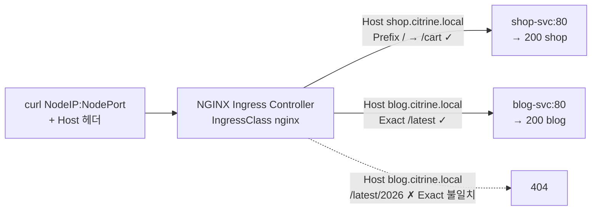

# q16 — Route two hosts with one Ingress · 풀이

← 문제: **[question.md](question.md)**

## 문제 (해석)

**원문**

> Namespace `citrine` runs two web applications behind Services `shop-svc` and `blog-svc`
> (both on port `80`). Publish both through one Ingress using host-based rules.
>
> 1. Create an Ingress named `gems` in namespace `citrine` with IngressClass `nginx` and these rules:
>    - host `shop.citrine.local`, path `/`, path type `Prefix` → Service `shop-svc` port `80`
>    - host `blog.citrine.local`, path `/latest`, path type `Exact` → Service `blog-svc` port `80`
> 2. Send these three requests to the Ingress controller's NodePort and write the three HTTP status
>    codes, one per line in this order, to `/opt/course/e16/codes.txt`:
>    `Host: shop.citrine.local` path `/cart`; `Host: blog.citrine.local` path `/latest`;
>    `Host: blog.citrine.local` path `/latest/2026`.

**해석**

`citrine` 네임스페이스는 Service `shop-svc` 와 `blog-svc`(둘 다 포트 `80`) 뒤에서 두 웹 애플리케이션을
돌린다. 호스트 기반 규칙으로 하나의 Ingress 를 통해 둘 다 공개한다.

1. `citrine` 네임스페이스에 IngressClass `nginx` 를 쓰는 Ingress `gems` 를 만들고 규칙은 다음과 같다:
   - 호스트 `shop.citrine.local`, 경로 `/`, path type `Prefix` → Service `shop-svc` 포트 `80`
   - 호스트 `blog.citrine.local`, 경로 `/latest`, path type `Exact` → Service `blog-svc` 포트 `80`
2. Ingress 컨트롤러의 NodePort 로 다음 세 요청을 보내고, 세 HTTP 상태 코드를 이 순서대로 한 줄에
   하나씩 `/opt/course/e16/codes.txt` 에 쓴다:
   `Host: shop.citrine.local` 경로 `/cart`; `Host: blog.citrine.local` 경로 `/latest`;
   `Host: blog.citrine.local` 경로 `/latest/2026`.

## 모범 풀이

**1) Ingress — 명령형 한 줄**

```bash
kubectl get ingressclass                       # nginx
kubectl -n citrine create ingress gems --class=nginx \
  --rule='shop.citrine.local/*=shop-svc:80' \
  --rule='blog.citrine.local/latest=blog-svc:80'
```

`--rule` 의 경로 끝에 `*` 가 있으면 `Prefix`, 없으면 `Exact` 입니다. `/*` 는 경로 `/` + `Prefix` 가 됩니다.
같은 결과의 YAML:

```yaml
apiVersion: networking.k8s.io/v1
kind: Ingress
metadata:
  name: gems
  namespace: citrine
spec:
  ingressClassName: nginx
  rules:
  - host: shop.citrine.local
    http:
      paths:
      - path: /
        pathType: Prefix
        backend:
          service:
            name: shop-svc
            port:
              number: 80
  - host: blog.citrine.local
    http:
      paths:
      - path: /latest
        pathType: Exact
        backend:
          service:
            name: blog-svc
            port:
              number: 80
```

```bash
kubectl -n citrine describe ingress gems        # Rules 에 두 호스트, Backends 에 파드 IP
```

**2) 세 요청의 상태 코드**

```bash
NP=$(kubectl -n nginx-ingress get svc nginx-ingress -o jsonpath='{.spec.ports[?(@.name=="http")].nodePort}')
NODE=$(kubectl get nodes -o jsonpath='{.items[0].status.addresses[?(@.type=="InternalIP")].address}')
c() { curl -s -o /dev/null -w '%{http_code}\n' -H "Host: $1" "http://$NODE:$NP$2"; }
{ c shop.citrine.local /cart; c blog.citrine.local /latest; c blog.citrine.local /latest/2026; } \
  > /opt/course/e16/codes.txt
cat /opt/course/e16/codes.txt
# 200
# 200
# 404
```

- `/cart` 는 `Prefix /` 에 맞습니다. `/` Prefix 는 그 호스트의 모든 경로를 받습니다.
- `/latest` 는 `Exact /latest` 와 정확히 같아 200 입니다.
- `/latest/2026` 은 Exact 와 다르고 blog 호스트에는 다른 규칙이 없어 컨트롤러가 404 를 돌려줍니다.
  `Prefix /latest` 였다면 200 이었을 것입니다.

### 그림 — 호스트와 경로로 갈라지는 요청



1. 컨트롤러는 먼저 `Host` 헤더로 규칙(호스트)을 고릅니다. Host 가 없거나 다르면 어느 규칙에도 맞지 않습니다.
2. 고른 호스트 안에서 경로를 비교합니다. `Prefix` 는 `/` 로 나뉜 경로 요소 단위 앞부분 일치, `Exact` 는 대소문자까지 완전 일치입니다.
3. 맞는 경로가 없으면 백엔드로 보내지 않고 컨트롤러가 404 를 직접 응답합니다.

## 검증

```bash
kubectl -n citrine get ingress gems
# NAME   CLASS   HOSTS                                  ADDRESS   PORTS   AGE
# gems   nginx   shop.citrine.local,blog.citrine.local             80      1m
kubectl -n citrine get ingress gems -o jsonpath='{range .spec.rules[*]}{.host} {.http.paths[0].path} {.http.paths[0].pathType} {.http.paths[0].backend.service.name}{"\n"}{end}'
# shop.citrine.local / Prefix shop-svc
# blog.citrine.local /latest Exact blog-svc
cat /opt/course/e16/codes.txt          # 200 / 200 / 404
curl -s -H 'Host: blog.citrine.local' http://$NODE:$NP/latest     # blog
```

## 오답 원인 / 배운 점

- **왜 틀렸나**:
- **기억할 것**: `kubectl create ingress --rule='host/path*=svc:port'` — `*` 가 있으면 Prefix, 없으면 Exact.
- **헷갈리는 지점**: `Prefix /latest` 는 `/latest/2026` 을 받지만 `/latestnews` 는 받지 않습니다(요소 단위). Ingress NGINX(kubernetes/ingress-nginx) 프로젝트는 2026-03 에 은퇴했지만 Ingress API 는 GA 그대로이고, 이 실습은 F5 NGINX Ingress Controller 를 씁니다. 컨트롤러 전용 어노테이션 없이 표준 필드만 쓰면 어느 컨트롤러든 같은 결과입니다. CKAD 에서는 Gateway API 가 아니라 Ingress 로 출제됩니다.

## 참고 문서

- 검색어: `ingress`, `ingress path types`, `kubectl create ingress`
- https://kubernetes.io/docs/concepts/services-networking/ingress/
- https://kubernetes.io/docs/reference/kubectl/generated/kubectl_create/kubectl_create_ingress/

---

[↑ 문항 목록](../README.md) · [← 문제로](question.md) · [다음 문제 q17 →](../q17_networkpolicy_default_deny/question.md)
