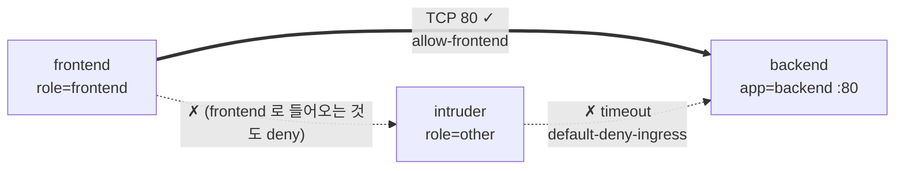

# q17 — Default-deny ingress and allow only the frontend · 풀이

← 문제: **[question.md](question.md)**

## 문제 (해석)

**원문**

> In namespace `zircon`, pod `backend` accepts traffic from every pod. Lock the namespace down so
> that only the frontend can reach the backend.
>
> 1. Create a NetworkPolicy named `default-deny-ingress` in namespace `zircon` that denies all
>    incoming traffic to every pod in the namespace.
> 2. Create a NetworkPolicy named `allow-frontend` in namespace `zircon` that allows pods with label
>    `role=frontend` to connect to pods with label `app=backend` on TCP port `80` only.
> 3. Confirm that `frontend` can fetch `http://backend` and that `intruder` cannot (the request
>    must time out).

**해석**

`zircon` 네임스페이스의 파드 `backend` 는 모든 파드의 트래픽을 받는다. frontend 만 backend 에 닿을 수
있도록 네임스페이스를 잠근다.

1. `zircon` 네임스페이스의 모든 파드로 들어오는 트래픽을 전부 막는 NetworkPolicy `default-deny-ingress`
   를 만든다.
2. 라벨 `role=frontend` 인 파드가 라벨 `app=backend` 인 파드의 TCP 포트 `80` 으로만 접속할 수 있게
   허용하는 NetworkPolicy `allow-frontend` 를 `zircon` 네임스페이스에 만든다.
3. `frontend` 는 `http://backend` 를 가져올 수 있고 `intruder` 는 못 하는지(요청이 시간 초과되어야
   한다) 확인한다.

## 모범 풀이

**0) 정책 전 상태**

```bash
kubectl -n zircon get pods --show-labels
kubectl -n zircon exec intruder -- wget -qO- -T 2 http://backend | head -1    # 지금은 접속됨
```

**1) default deny (ingress)**

```yaml
# /tmp/e17-deny.yaml
apiVersion: networking.k8s.io/v1
kind: NetworkPolicy
metadata:
  name: default-deny-ingress
  namespace: zircon
spec:
  podSelector: {}          # 네임스페이스의 모든 파드
  policyTypes:
  - Ingress                # ingress 규칙이 하나도 없으므로 전부 거부
```

`podSelector: {}` 는 "모든 파드"이고, `ingress:` 를 아예 쓰지 않으면 허용 규칙이 0개라 전부 막힙니다.
반대로 `ingress: [{}]` 처럼 빈 규칙 하나를 넣으면 **전부 허용**이 되니 주의합니다. Egress 는
`policyTypes` 에 없으므로 그대로 열려 있습니다(DNS 조회도 계속 됩니다).

**2) frontend → backend:80 허용**

```yaml
# /tmp/e17-allow.yaml
apiVersion: networking.k8s.io/v1
kind: NetworkPolicy
metadata:
  name: allow-frontend
  namespace: zircon
spec:
  podSelector:
    matchLabels:
      app: backend          # 이 정책이 보호하는 파드
  policyTypes:
  - Ingress
  ingress:
  - from:
    - podSelector:
        matchLabels:
          role: frontend    # 같은 네임스페이스의 frontend 파드
    ports:
    - protocol: TCP
      port: 80
```

```bash
kubectl apply -f /tmp/e17-deny.yaml -f /tmp/e17-allow.yaml
kubectl -n zircon get netpol
```

NetworkPolicy 는 **합집합**입니다. 두 정책이 함께 backend 를 고르면 "deny 의 허용 0개 + allow 의 허용
1개" 로 frontend 만 열립니다. 정책끼리 순서나 우선순위는 없습니다. `from` 아래 `podSelector` 만 있으면
같은 네임스페이스 파드만 뜻합니다. `ports.port` 는 Service 포트가 아니라 **파드(컨테이너) 포트**입니다
(여기서는 둘 다 80).

**3) 확인**

```bash
kubectl -n zircon exec frontend -- wget -qO- -T 2 http://backend | head -1
# <!DOCTYPE html>
kubectl -n zircon exec intruder -- wget -qO- -T 2 http://backend
# wget: download timed out
# command terminated with exit code 1
```

막힌 트래픽은 거부 응답 없이 버려지므로 "connection refused" 가 아니라 **시간 초과**로 보입니다.

### 그림 — 허용 경로



1. `default-deny-ingress` 가 네임스페이스의 모든 파드(backend, frontend, intruder)를 고르고 들어오는 트래픽을 전부 막습니다.
2. `allow-frontend` 가 backend 에 대해서만 `role=frontend` 출발, TCP 80 도착을 허용합니다. 두 정책의 허용 규칙이 합쳐져 이 경로 하나만 열립니다.
3. intruder 의 요청은 어떤 허용 규칙에도 맞지 않아 버려지고, 클라이언트에서는 시간 초과로 보입니다.

## 검증

```bash
kubectl -n zircon get netpol
# NAME                   POD-SELECTOR   AGE
# allow-frontend         app=backend    1m
# default-deny-ingress   <none>         1m
kubectl -n zircon exec frontend -- wget -qO- -T 2 http://backend >/dev/null && echo allowed    # allowed
kubectl -n zircon exec intruder -- wget -qO- -T 2 http://backend >/dev/null || echo blocked    # blocked
kubectl -n zircon describe netpol allow-frontend
```

## 오답 원인 / 배운 점

- **왜 틀렸나**:
- **기억할 것**: default deny = `podSelector: {}` + `policyTypes: [Ingress]` + ingress 규칙 없음. 정책은 합집합이다.
- **헷갈리는 지점**: `from` 의 한 항목 안에 `namespaceSelector` 와 `podSelector` 를 같이 쓰면 AND, 별도의 `-` 항목으로 쓰면 OR 입니다. egress 까지 막는 default deny 를 만들면 DNS(UDP/TCP 53)를 따로 열어야 `http://backend` 이름 조회가 됩니다. 정책이 집행되는지는 CNI 에 달려 있습니다.

## 참고 문서

- 검색어: `network policies`, `default deny`
- https://kubernetes.io/docs/concepts/services-networking/network-policies/
- https://kubernetes.io/docs/tasks/administer-cluster/declare-network-policy/

---

[↑ 문항 목록](../README.md) · [← 문제로](question.md)
