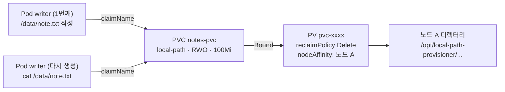

# q03 — Persist data with a PersistentVolumeClaim · 풀이

← 문제: **[question.md](question.md)**

## 문제 (해석)

**원문**

> The note-taking Pod in namespace `nile` loses its data whenever it is recreated. Give it storage
> that outlives the Pod.
>
> 1. Create a PersistentVolumeClaim `notes-pvc` in namespace `nile` with `storageClassName: local-path`,
>    access mode `ReadWriteOnce` and a storage request of `100Mi`.
> 2. Create a Pod `writer` in namespace `nile` (image `busybox:1.36`, command `sleep 3600`) that mounts
>    the claim at `/data`. Save the Pod manifest to `/opt/course/f03/writer.yaml`.
> 3. Write the text `persisted-f03` to `/data/note.txt` inside the Pod. Then delete the Pod, create it
>    again from `/opt/course/f03/writer.yaml`, and write the output of `cat /data/note.txt` from the
>    new Pod to `/opt/course/f03/after-recreate.txt`.

**해석**

`nile` 네임스페이스의 메모용 Pod 는 다시 만들어질 때마다 데이터를 잃는다. Pod 보다 오래 사는 저장소를 준다.

1. `nile` 네임스페이스에 `storageClassName: local-path`, 접근 모드 `ReadWriteOnce`, 저장 용량 요청
   `100Mi` 인 PersistentVolumeClaim `notes-pvc` 를 만든다.
2. 이 클레임을 `/data` 에 마운트하는 Pod `writer` (이미지 `busybox:1.36`, 명령 `sleep 3600`)를 `nile` 에
   만든다. Pod 매니페스트는 `/opt/course/f03/writer.yaml` 로 저장한다.
3. Pod 안에서 `/data/note.txt` 에 `persisted-f03` 을 쓴다. 그다음 Pod 를 지우고
   `/opt/course/f03/writer.yaml` 로 다시 만든 뒤, 새 Pod 에서 `cat /data/note.txt` 한 출력을
   `/opt/course/f03/after-recreate.txt` 에 적는다.

## 모범 풀이

**1) PVC** — 명령형 생성기가 없으므로 YAML 로 만듭니다.

```bash
cat <<'YAML' | kubectl apply -f -
apiVersion: v1
kind: PersistentVolumeClaim
metadata:
  name: notes-pvc
  namespace: nile
spec:
  storageClassName: local-path
  accessModes:
  - ReadWriteOnce
  resources:
    requests:
      storage: 100Mi
YAML
kubectl -n nile get pvc notes-pvc
# notes-pvc   Pending   ...   local-path   5s     ← 정상
```

`local-path` StorageClass 는 `volumeBindingMode: WaitForFirstConsumer` 라서 이 PVC 를 쓰는 Pod 가
스케줄될 때까지 `Pending` 입니다. 고장이 아니니 Pod 를 만들고 다시 봅니다.

**2) Pod 매니페스트**

```bash
kubectl -n nile run writer --image=busybox:1.36 --dry-run=client -o yaml \
  --command -- sleep 3600 > /opt/course/f03/writer.yaml
```

`spec` 에 `volumes` 와 `volumeMounts` 를 추가합니다.

```yaml
# /opt/course/f03/writer.yaml
apiVersion: v1
kind: Pod
metadata:
  name: writer
  namespace: nile
  labels:
    run: writer
spec:
  containers:
  - name: writer
    image: busybox:1.36
    command: ["sleep", "3600"]
    volumeMounts:
    - name: notes
      mountPath: /data
  volumes:
  - name: notes
    persistentVolumeClaim:
      claimName: notes-pvc
```

```bash
kubectl apply -f /opt/course/f03/writer.yaml
kubectl -n nile wait pod writer --for=condition=Ready --timeout=120s
kubectl -n nile get pvc notes-pvc        # 이제 Bound
```

**3) 쓰고, 지우고, 다시 만들어 읽기**

```bash
kubectl -n nile exec writer -- sh -c 'echo persisted-f03 > /data/note.txt'
kubectl -n nile delete pod writer
kubectl apply -f /opt/course/f03/writer.yaml
kubectl -n nile wait pod writer --for=condition=Ready --timeout=120s
kubectl -n nile exec writer -- cat /data/note.txt > /opt/course/f03/after-recreate.txt
cat /opt/course/f03/after-recreate.txt
# persisted-f03
```

local-path 볼륨은 노드의 디렉터리라 PV 에 nodeAffinity 가 붙습니다. 그래서 새 Pod 는 같은 노드로 자동
스케줄되어 같은 데이터를 봅니다. Pod 를 지워도 PVC 가 남아 있는 한 PV 와 데이터는 그대로입니다.

### 그림 — Pod 를 지워도 데이터가 남는 이유



1. PVC 는 Pod 와 별개의 객체라 Pod 를 지워도 남습니다. 처음 Pod 가 스케줄될 때 프로비저너가 PV 를 만들고 PVC 에 묶습니다.
2. PV 는 노드 A 의 디렉터리이고 nodeAffinity 로 그 노드에 고정됩니다.
3. 다시 만든 Pod 도 같은 `claimName` 을 쓰므로 스케줄러가 노드 A 로 보내고, 같은 디렉터리가 `/data` 에 마운트됩니다.
4. PVC 를 지우면 `reclaimPolicy: Delete` 라 PV 와 디렉터리도 지워집니다. 데이터를 지키는 것은 PVC 의 수명입니다.

## 검증

```bash
kubectl -n nile get pvc notes-pvc
# NAME        STATUS   VOLUME      CAPACITY   ACCESS MODES   STORAGECLASS   AGE
# notes-pvc   Bound    pvc-...     100Mi      RWO            local-path     2m
kubectl -n nile get pod writer -o jsonpath='{.spec.volumes[0].persistentVolumeClaim.claimName}{"\n"}'
# notes-pvc
kubectl -n nile exec writer -- cat /data/note.txt     # persisted-f03
cat /opt/course/f03/after-recreate.txt                # persisted-f03
```

## 오답 원인 / 배운 점

- **왜 틀렸나**:
- **기억할 것**: PVC 는 `storageClassName`·`accessModes`·`resources.requests.storage` 세 줄, Pod 는 `volumes[].persistentVolumeClaim.claimName` + `volumeMounts[].mountPath`.
- **헷갈리는 지점**: `WaitForFirstConsumer` StorageClass 의 PVC 는 Pod 가 생길 때까지 `Pending` 이 정상입니다. `emptyDir` 은 Pod 와 함께 사라지므로 "재생성 후에도 유지" 요구에는 맞지 않습니다.

## 참고 문서

- 검색어: `persistent volumes`, `configure a pod to use a persistentvolume`
- https://kubernetes.io/docs/concepts/storage/persistent-volumes/
- https://kubernetes.io/docs/tasks/configure-pod-container/configure-persistent-volume-storage/

---

[↑ 문항 목록](../README.md) · [← 문제로](question.md) · [다음 문제 q04 →](../q04_canary_shared_service/question.md)
