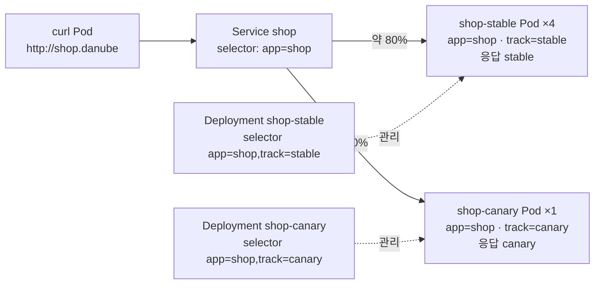

# q04 — Canary release with replica ratios · 풀이

← 문제: **[question.md](question.md)**

## 문제 (해석)

**원문**

> Namespace `danube` runs the stable version of the shop application as Deployment `shop-stable`
> (4 replicas) behind Service `shop`. Release a canary version so that roughly one in five requests
> reaches it.
>
> 1. Create a Deployment `shop-canary` in namespace `danube` with `1` replica. Base its Pod template
>    on `shop-stable`, but use the label `track: canary` instead of `track: stable`, and make the
>    container answer `canary` (argument `-text=canary`). The selector of `shop-canary` must not
>    match the stable Pods.
> 2. Do not modify Service `shop` or Deployment `shop-stable`. Confirm that the EndpointSlice of
>    Service `shop` now lists `5` ready endpoints, and write that number to
>    `/opt/course/f04/endpoints.txt`.
> 3. From a temporary Pod using image `curlimages/curl:8.10.1`, send 20 requests to
>    `http://shop.danube` and write the responses, one per line, to `/opt/course/f04/responses.txt`.

**해석**

`danube` 네임스페이스는 shop 애플리케이션의 안정 버전을 Deployment `shop-stable`(4 replicas)로 Service
`shop` 뒤에서 돌리고 있다. 요청 다섯 개 중 하나 정도가 새 버전에 닿도록 canary 버전을 내보낸다.

1. `danube` 에 replica `1` 개인 Deployment `shop-canary` 를 만든다. Pod 템플릿은 `shop-stable` 을 바탕으로
   하되 라벨은 `track: stable` 대신 `track: canary` 를 쓰고, 컨테이너가 `canary` 로 응답하게 한다(인자
   `-text=canary`). `shop-canary` 의 selector 는 stable Pod 와 맞으면 안 된다.
2. Service `shop` 과 Deployment `shop-stable` 은 바꾸지 않는다. Service `shop` 의 EndpointSlice 에 ready
   endpoint 가 `5` 개인지 확인하고 그 숫자를 `/opt/course/f04/endpoints.txt` 에 적는다.
3. 이미지 `curlimages/curl:8.10.1` 로 임시 Pod 를 띄워 `http://shop.danube` 로 요청 20번을 보내고, 응답을
   한 줄에 하나씩 `/opt/course/f04/responses.txt` 에 적는다.

## 모범 풀이

**1) stable 을 복사해 canary Deployment 만들기**

```bash
kubectl -n danube get deploy shop-stable -o yaml > /tmp/canary.yaml
```

복사한 파일에서 `status`, `metadata` 의 `uid`·`resourceVersion`·`creationTimestamp`·`generation`·
`annotations` 를 지우고 아래처럼 고칩니다. 바꾸는 곳은 이름, replicas, `track` 라벨(세 군데), 인자뿐입니다.

```yaml
apiVersion: apps/v1
kind: Deployment
metadata:
  name: shop-canary              # 이름
  namespace: danube
  labels:
    app: shop
    track: canary                # 1
spec:
  replicas: 1                    # 4 → 1
  selector:
    matchLabels:
      app: shop
      track: canary              # 2 — stable Pod 와 겹치지 않게
  template:
    metadata:
      labels:
        app: shop                # Service selector 가 보는 공통 라벨은 그대로
        track: canary            # 3
    spec:
      containers:
      - name: echo
        image: hashicorp/http-echo:1.0
        args: ["-text=canary"]
        ports:
        - containerPort: 5678
```

```bash
kubectl apply -f /tmp/canary.yaml
kubectl -n danube rollout status deploy shop-canary
```

Service `shop` 의 selector 는 `app: shop` 하나라서 두 Deployment 의 Pod 를 모두 잡습니다. 반대로 Deployment
selector 에 `app: shop` 만 쓰면 canary 의 ReplicaSet 과 stable 의 ReplicaSet 이 같은 Pod 를 놓고
다투므로, Deployment selector 에는 반드시 `track` 까지 넣습니다.

**2) EndpointSlice 확인** — Endpoints API 는 v1.33 부터 deprecated 이므로 EndpointSlice 를 봅니다.

```bash
kubectl -n danube get endpointslice -l kubernetes.io/service-name=shop
# NAME         ADDRESSTYPE   PORTS   ENDPOINTS                                   AGE
# shop-xxxxx   IPv4          5678    10.0.1.11,10.0.1.12,10.0.2.7 + 2 more...    5m

kubectl -n danube get endpointslice -l kubernetes.io/service-name=shop \
  -o jsonpath='{range .items[*].endpoints[?(@.conditions.ready==true)]}{.addresses[0]}{"\n"}{end}' | wc -l
# 5
echo 5 > /opt/course/f04/endpoints.txt
```

**3) 트래픽 비율 확인**

```bash
kubectl -n danube run tmp --rm -i --restart=Never --image=curlimages/curl:8.10.1 -- \
  sh -c 'for i in $(seq 1 20); do curl -s http://shop.danube; done' \
  | grep -E '^(stable|canary)$' > /opt/course/f04/responses.txt
sort /opt/course/f04/responses.txt | uniq -c
#   4 canary
#  16 stable        ← 대략 1:4, 매번 조금씩 다르다
```

`grep` 은 `kubectl run --rm` 이 덧붙이는 `pod "tmp" deleted` 같은 줄을 걸러 냅니다. kube-proxy 의 분배는
무작위라 정확히 4:16 이 나오지 않을 수 있습니다. 비율은 replica 수로만 조절됩니다.

### 그림 — replica 수로 나누는 canary



1. Service 는 공통 라벨 `app=shop` 만 보므로 두 Deployment 의 Pod 5개가 모두 EndpointSlice 에 들어갑니다.
2. kube-proxy 는 endpoint 마다 거의 같은 확률로 보내므로 canary 비율은 1/5, 약 20% 입니다.
3. 각 Deployment 는 `track` 까지 포함한 selector 로 자기 Pod 만 관리합니다. 비율을 바꾸려면 replicas 를 바꾸고, 롤백하려면 `shop-canary` 를 지우거나 0 으로 줄입니다.

## 검증

```bash
kubectl -n danube get deploy
# NAME          READY   UP-TO-DATE   AVAILABLE
# shop-canary   1/1     1            1
# shop-stable   4/4     4            4
kubectl -n danube get pods -l app=shop -L track
cat /opt/course/f04/endpoints.txt                 # 5
wc -l < /opt/course/f04/responses.txt             # 20
grep -c canary /opt/course/f04/responses.txt      # 1 이상 (보통 2~6)
kubectl -n danube get svc shop -o jsonpath='{.spec.selector}{"\n"}'   # {"app":"shop"} — 그대로
```

## 오답 원인 / 배운 점

- **왜 틀렸나**:
- **기억할 것**: canary 는 "Service 가 보는 공통 라벨 + Deployment 마다 다른 track 라벨", 비율은 replica 수.
- **헷갈리는 지점**: Deployment selector 를 `app: shop` 만으로 두면 두 Deployment 가 서로의 Pod 를 자기 것으로 셉니다. Service 확인은 deprecated 된 `get ep` 대신 `get endpointslice -l kubernetes.io/service-name=shop`.

## 참고 문서

- 검색어: `canary deployment`, `managing resources canary`
- https://kubernetes.io/docs/concepts/workloads/management/#canary-deployments
- https://kubernetes.io/docs/concepts/services-networking/endpoint-slices/

---

[↑ 문항 목록](../README.md) · [← 문제로](question.md) · [다음 문제 q05 →](../q05_helm_upgrade_outdated_release/question.md)
