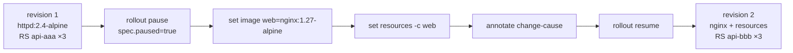

# q06 — Batch Deployment changes with rollout pause · 풀이

← 문제: **[question.md](question.md)**

## 문제 (해석)

**원문**

> Deployment `api` in namespace `seine` (container `web`) must move to a new image and get resource
> settings. Both changes must be rolled out together as a single new revision.
>
> 1. Pause the rollout of Deployment `api`.
> 2. While it is paused, change the image of container `web` to `nginx:1.27-alpine` and set its
>    resources to requests `cpu=100m,memory=64Mi` and limits `cpu=200m,memory=128Mi`. Record the
>    change cause `switch to nginx with resources` in the annotation `kubernetes.io/change-cause`.
> 3. Resume the rollout, wait until it has finished, and write the output of
>    `kubectl -n seine rollout history deployment api` to `/opt/course/f06/history.txt`. It must
>    show exactly one new revision (2 revisions in total) with that change cause.

**해석**

`seine` 네임스페이스의 Deployment `api`(컨테이너 `web`)는 새 이미지로 옮기고 리소스 설정을 받아야 한다. 두
변경은 하나의 새 리비전으로 함께 롤아웃되어야 한다.

1. Deployment `api` 의 롤아웃을 일시정지한다.
2. 일시정지된 동안 컨테이너 `web` 의 이미지를 `nginx:1.27-alpine` 으로 바꾸고, 리소스를 requests
   `cpu=100m,memory=64Mi`, limits `cpu=200m,memory=128Mi` 로 설정한다. 변경 사유
   `switch to nginx with resources` 를 어노테이션 `kubernetes.io/change-cause` 에 기록한다.
3. 롤아웃을 재개하고 끝날 때까지 기다린 뒤, `kubectl -n seine rollout history deployment api` 출력을
   `/opt/course/f06/history.txt` 에 적는다. 새 리비전이 정확히 하나(전체 2개)이고 그 변경 사유가 보여야 한다.

## 모범 풀이

**1) 일시정지**

```bash
kubectl -n seine rollout pause deploy api
# deployment.apps/api paused
```

**2) 일시정지 중에 변경 두 개 + change-cause**

```bash
kubectl -n seine set image deploy api web=nginx:1.27-alpine
kubectl -n seine set resources deploy api -c web \
  --requests=cpu=100m,memory=64Mi --limits=cpu=200m,memory=128Mi
kubectl -n seine annotate deploy api \
  kubernetes.io/change-cause="switch to nginx with resources" --overwrite

kubectl -n seine get rs          # 아직 ReplicaSet 은 revision 1 것 하나뿐
```

`set image` 의 `web=` 은 **컨테이너 이름**입니다. 일시정지 중에는 Pod 템플릿을 몇 번 바꿔도 컨트롤러가 새
ReplicaSet 을 만들지 않습니다. `--overwrite` 는 setup 이 이미 change-cause 를 달아 두었기 때문에 필요합니다
(없으면 `already has a value` 에러). `--record` 플래그는 deprecated 이므로 어노테이션을 직접 씁니다.

**3) 재개하고 히스토리 저장**

```bash
kubectl -n seine rollout resume deploy api
kubectl -n seine rollout status deploy api
kubectl -n seine rollout history deployment api > /opt/course/f06/history.txt
cat /opt/course/f06/history.txt
# deployment.apps/api
# REVISION  CHANGE-CAUSE
# 1         initial release httpd 2.4
# 2         switch to nginx with resources
```

일시정지를 풀지 않으면 `rollout status` 는 `Waiting for deployment "api" rollout to finish` 에서 멈추고,
`rollout undo` 도 일시정지 상태에서는 거부됩니다.

### 그림 — pause 동안 쌓인 변경이 한 리비전으로 나가는 과정



1. pause 는 Deployment 컨트롤러가 템플릿 변경에 반응하지 않게 합니다. 기존 Pod 는 그대로 서비스합니다.
2. 이미지, 리소스, 어노테이션을 차례로 바꿔도 새 ReplicaSet 이 만들어지지 않아 리비전이 늘지 않습니다.
3. resume 하는 순간 최종 템플릿 하나로 새 ReplicaSet(revision 2)이 만들어지고, change-cause 어노테이션이 그 ReplicaSet 으로 복사됩니다.
4. pause 없이 `set image` 와 `set resources` 를 따로 쳤다면 리비전이 2와 3, 두 개 생겼을 것입니다.

## 검증

```bash
kubectl -n seine get deploy api -o jsonpath='{.spec.paused}{"\n"}'     # (빈 값) — 일시정지 아님
kubectl -n seine get deploy api -o jsonpath='{.spec.template.spec.containers[0].image} {.spec.template.spec.containers[0].resources}{"\n"}'
# nginx:1.27-alpine {"limits":{"cpu":"200m","memory":"128Mi"},"requests":{"cpu":"100m","memory":"64Mi"}}
kubectl -n seine rollout history deploy api --revision=2 | head -5
cat /opt/course/f06/history.txt        # REVISION 1, 2 두 줄
kubectl -n seine get rs                # ReplicaSet 2개: 새 것 3/3, 옛 것 0
```

## 오답 원인 / 배운 점

- **왜 틀렸나**:
- **기억할 것**: `rollout pause` → 여러 `set ...` → `annotate kubernetes.io/change-cause=... --overwrite` → `rollout resume`.
- **헷갈리는 지점**: 일시정지된 Deployment 는 `rollout status` 가 끝나지 않고 `rollout undo` 도 안 됩니다. 어노테이션 변경만으로는 템플릿이 안 바뀌므로 리비전이 생기지 않습니다. `--record` 는 deprecated 입니다.

## 참고 문서

- 검색어: `pausing and resuming a deployment`, `kubectl rollout`
- https://kubernetes.io/docs/concepts/workloads/controllers/deployment/#pausing-and-resuming-a-rollout-of-a-deployment
- https://kubernetes.io/docs/reference/kubectl/generated/kubectl_rollout/

---

[↑ 문항 목록](../README.md) · [← 문제로](question.md) · [다음 문제 q07 →](../q07_readiness_probe_wrong_port/question.md)
