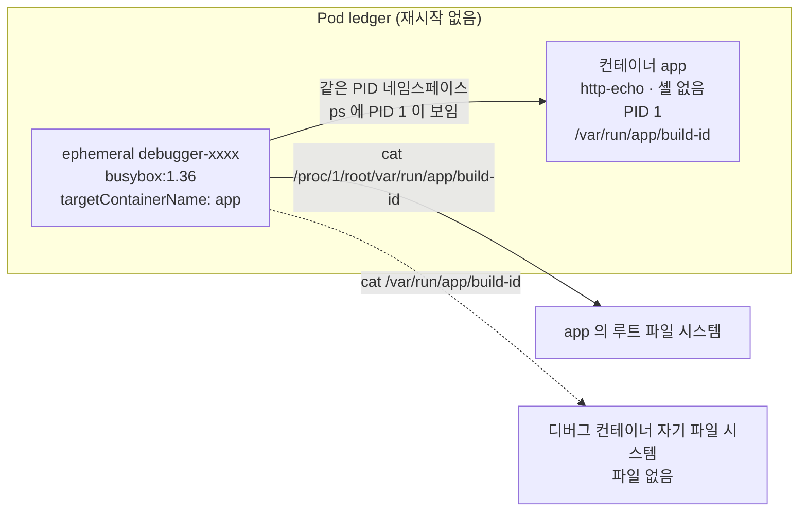

# q08 — Debug a container that has no shell · 풀이

← 문제: **[question.md](question.md)**

## 문제 (해석)

**원문**

> Pod `ledger` in namespace `yukon` runs container `app` from an image that contains no shell and no
> tools, so `kubectl exec` cannot be used to look inside it. At start-up the Pod places a build
> identifier in the file `/var/run/app/build-id` of container `app`.
>
> 1. Attach an ephemeral debug container that uses image `busybox:1.36` to Pod `ledger` and targets
>    container `app`, so that it shares the process namespace of `app`. Do not restart, recreate or
>    modify the Pod in any other way.
> 2. From the debug container, read the file `/var/run/app/build-id` as container `app` sees it and
>    write its exact content to `/opt/course/f08/build-id.txt`.

**해석**

`yukon` 네임스페이스의 Pod `ledger` 는 셸도 도구도 없는 이미지로 컨테이너 `app` 을 돌리므로 `kubectl exec`
로 안을 들여다볼 수 없다. Pod 는 시작할 때 컨테이너 `app` 의 파일 `/var/run/app/build-id` 에 빌드 식별자를 둔다.

1. 이미지 `busybox:1.36` 을 쓰는 ephemeral 디버그 컨테이너를 Pod `ledger` 에 붙이되, 컨테이너 `app` 을
   대상으로 해 `app` 의 프로세스 네임스페이스를 공유하게 한다. Pod 를 재시작·재생성하거나 다른 방식으로 바꾸지 않는다.
2. 디버그 컨테이너에서 컨테이너 `app` 이 보는 `/var/run/app/build-id` 파일을 읽어, 그 내용을 그대로
   `/opt/course/f08/build-id.txt` 에 적는다.

## 모범 풀이

**0) exec 가 안 되는 것 확인**

```bash
kubectl -n yukon exec ledger -c app -- sh
# error: ... exec: "sh": executable file not found in $PATH
```

**1) ephemeral 디버그 컨테이너 붙이기**

```bash
kubectl -n yukon debug -it ledger --image=busybox:1.36 --target=app --profile=general
# Targeting container "app". If you don't see processes from this container it may be because
# the container runtime doesn't support this feature.
# Defaulting debug container name to debugger-abcde.
/ # ps
# PID   USER     TIME  COMMAND
#     1 root      0:00 /http-echo -text=ledger -listen=:5678     ← app 의 프로세스가 PID 1
#    12 root      0:00 sh
```

`--target=app` 은 ephemeral container 의 `targetContainerName` 을 채워 `app` 의 PID 네임스페이스에
들어가게 합니다. 그래서 `ps` 에 `app` 의 프로세스가 보입니다. `kubectl debug` 에 `--copy-to` 를 주면
Pod 사본을 새로 만들므로 "Pod 를 바꾸지 않는다"는 요구와 다른 길입니다. 여기서는 쓰지 않습니다.

**2) app 의 파일 시스템 읽기** — 디버그 컨테이너의 `/` 는 busybox 이미지입니다. `app` 의 파일 시스템은
`app` 프로세스(PID 1)의 루트, 즉 `/proc/1/root` 아래에 있습니다.

```bash
/ # ls /var/run/app
# ls: /var/run/app: No such file or directory          ← 디버그 컨테이너 자기 파일 시스템
/ # cat /proc/1/root/var/run/app/build-id
# f08-3fa91c0d22be
/ # exit
```

로컬 파일로 저장하려면 같은 디버그 방식으로 한 번 더 비대화식으로 실행합니다(stderr 의 안내 문구는 버립니다).

```bash
kubectl -n yukon debug ledger --image=busybox:1.36 --target=app --profile=general -i -q -- \
  cat /proc/1/root/var/run/app/build-id 2>/dev/null > /opt/course/f08/build-id.txt
cat /opt/course/f08/build-id.txt
# f08-3fa91c0d22be
```

`/proc/<pid>/root` 를 따라가려면 그 프로세스에 대한 ptrace 읽기 권한이 필요합니다. `--profile=general` 은
디버그 컨테이너에 `SYS_PTRACE` 를 더해 대상 컨테이너가 다른 UID 로 돌아도 읽을 수 있게 합니다.

### 그림 — ephemeral container 가 app 의 파일을 보는 길



1. `kubectl debug --target=app` 은 Pod 의 `ephemeralContainers` 서브리소스에 컨테이너를 추가합니다. Pod 는 재시작되지 않습니다.
2. 디버그 컨테이너는 `app` 과 PID 네임스페이스를 공유하므로 `app` 의 프로세스가 PID 1 로 보입니다.
3. 파일 시스템(마운트 네임스페이스)은 공유되지 않아, 그냥 경로를 치면 busybox 자기 파일 시스템을 봅니다.
4. `/proc/1/root` 는 PID 1 프로세스가 보는 루트이므로 그 아래로 `app` 의 볼륨 마운트까지 그대로 읽힙니다.

## 검증

```bash
kubectl -n yukon get pod ledger
# NAME     READY   STATUS    RESTARTS   AGE
# ledger   1/1     Running   0          5m          ← RESTARTS 0, AGE 그대로
kubectl -n yukon get pod ledger -o jsonpath='{range .spec.ephemeralContainers[*]}{.name} {.image} target={.targetContainerName}{"\n"}{end}'
# debugger-abcde busybox:1.36 target=app
cat /opt/course/f08/build-id.txt     # f08-<12자리 16진수>
```

## 오답 원인 / 배운 점

- **왜 틀렸나**:
- **기억할 것**: 셸 없는 컨테이너는 `kubectl debug -it <pod> --image=busybox:1.36 --target=<c>`, 대상의 파일은 `/proc/1/root/<경로>`.
- **헷갈리는 지점**: `--target` 은 프로세스만 공유하고 파일 시스템은 공유하지 않습니다. ephemeral container 는 한 번 추가하면 지울 수 없고(Pod 를 다시 만들어야 함) `resources`·`ports`·probe 를 가질 수 없습니다.

## 참고 문서

- 검색어: `debug running pods ephemeral container`, `kubectl debug`
- https://kubernetes.io/docs/tasks/debug/debug-application/debug-running-pod/#ephemeral-container
- https://kubernetes.io/docs/concepts/workloads/pods/ephemeral-containers/

---

[↑ 문항 목록](../README.md) · [← 문제로](question.md) · [다음 문제 q09 →](../q09_multi_container_logs/question.md)
