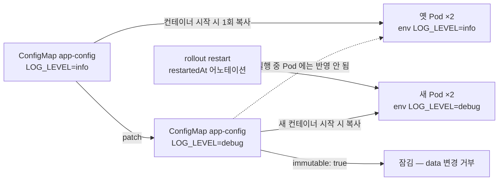

# q10 — Roll out a ConfigMap change and lock it · 풀이

← 문제: **[question.md](question.md)**

## 문제 (해석)

**원문**

> Deployment `reporter` in namespace `ganges` reads its settings from ConfigMap `app-config` as
> environment variables.
>
> 1. Change the value of key `LOG_LEVEL` in ConfigMap `app-config` to `debug`. Leave the other keys
>    unchanged.
> 2. Make the Pods of Deployment `reporter` use the new value by using a `kubectl rollout` command
>    (do not edit the Deployment manifest by hand). Write the value of `LOG_LEVEL` as seen inside
>    one of the new Pods to `/opt/course/f10/log-level.txt`.
> 3. Make ConfigMap `app-config` immutable.

**해석**

`ganges` 네임스페이스의 Deployment `reporter` 는 ConfigMap `app-config` 의 설정을 환경 변수로 읽는다.

1. ConfigMap `app-config` 의 키 `LOG_LEVEL` 값을 `debug` 로 바꾼다. 다른 키는 그대로 둔다.
2. `kubectl rollout` 명령을 써서(Deployment 매니페스트를 손으로 고치지 않고) Deployment `reporter` 의 Pod 가
   새 값을 쓰게 한다. 새 Pod 하나에서 보이는 `LOG_LEVEL` 값을 `/opt/course/f10/log-level.txt` 에 적는다.
3. ConfigMap `app-config` 를 immutable 로 만든다.

## 모범 풀이

**1) ConfigMap 값 변경**

```bash
kubectl -n ganges patch cm app-config -p '{"data":{"LOG_LEVEL":"debug"}}'
kubectl -n ganges get cm app-config -o jsonpath='{.data}{"\n"}'
# {"LOG_LEVEL":"debug","REGION":"eu-west"}

kubectl -n ganges exec deploy/reporter -- printenv LOG_LEVEL
# info              ← 실행 중인 Pod 는 아직 옛 값
```

merge patch 는 준 키만 바꾸므로 `REGION` 이 남습니다. `kubectl create cm ... --from-literal=LOG_LEVEL=debug $do | kubectl apply -f -`
처럼 다시 만들면 `REGION` 이 빠지니 주의합니다.

**2) rollout restart 로 새 Pod 띄우기**

```bash
kubectl -n ganges rollout restart deploy reporter
kubectl -n ganges rollout status deploy reporter
kubectl -n ganges exec deploy/reporter -- printenv LOG_LEVEL > /opt/course/f10/log-level.txt
cat /opt/course/f10/log-level.txt
# debug
```

환경 변수(`env`/`envFrom`)는 컨테이너가 **시작할 때 한 번** 채워지고 이후 바뀌지 않습니다. `rollout restart`
는 Pod 템플릿에 `kubectl.kubernetes.io/restartedAt` 어노테이션을 넣어 새 ReplicaSet 을 만들게 하므로, 새 Pod 가
시작하면서 바뀐 값을 읽습니다. (볼륨으로 마운트한 ConfigMap 은 kubelet 이 1분 안팎으로 파일을 갱신하지만, `subPath`
마운트는 갱신되지 않습니다.)

**3) immutable 로 잠그기**

```bash
kubectl -n ganges patch cm app-config -p '{"immutable":true}'
kubectl -n ganges patch cm app-config -p '{"data":{"LOG_LEVEL":"warn"}}'
# The ConfigMap "app-config" is invalid: data: Forbidden: field is immutable when `immutable` is set
```

`immutable` 은 `data` 와 같은 높이의 최상위 필드입니다. 한 번 `true` 로 바꾸면 되돌릴 수 없고, 값을 바꾸려면
ConfigMap 을 지우고 다시 만들어야 합니다. 대신 kubelet 이 이 ConfigMap 을 감시하지 않아 API 서버 부하가 줄어듭니다.

### 그림 — env 로 받은 값이 언제 바뀌는가



1. env 로 주입된 값은 컨테이너 시작 시점의 복사본이라, ConfigMap 을 바꿔도 실행 중인 Pod 는 옛 값을 유지합니다.
2. `rollout restart` 로 새 ReplicaSet 이 생기고, 새 Pod 의 컨테이너가 시작하면서 바뀐 ConfigMap 을 읽습니다.
3. 마지막으로 `immutable: true` 를 주면 이후의 `data` 변경이 거부됩니다.

## 검증

```bash
kubectl -n ganges get cm app-config -o jsonpath='{.data.LOG_LEVEL} {.data.REGION} {.immutable}{"\n"}'
# debug eu-west true
kubectl -n ganges get pods -l app=reporter
# reporter-<새 hash>-xxxxx   1/1   Running   0   1m   (2개, AGE 가 새로움)
kubectl -n ganges logs deploy/reporter | head -1
# start LOG_LEVEL=debug REGION=eu-west
cat /opt/course/f10/log-level.txt       # debug
kubectl -n ganges rollout history deploy reporter     # revision 2개
```

## 오답 원인 / 배운 점

- **왜 틀렸나**:
- **기억할 것**: env 로 쓰는 ConfigMap 을 바꾸면 `kubectl rollout restart deploy <name>` 이 필요하다. 잠그기는 `patch cm <name> -p '{"immutable":true}'`.
- **헷갈리는 지점**: 볼륨 마운트는 자동 갱신(단 `subPath` 제외), env 는 재시작해야 반영됩니다. `immutable` 은 되돌릴 수 없고 `data` 아래가 아니라 최상위 필드입니다.

## 참고 문서

- 검색어: `configmap immutable`, `configure a pod to use a configmap`
- https://kubernetes.io/docs/concepts/configuration/configmap/#configmap-immutable
- https://kubernetes.io/docs/tasks/configure-pod-container/configure-pod-configmap/

---

[↑ 문항 목록](../README.md) · [← 문제로](question.md) · [다음 문제 q11 →](../q11_serviceaccount_token_automount/question.md)
