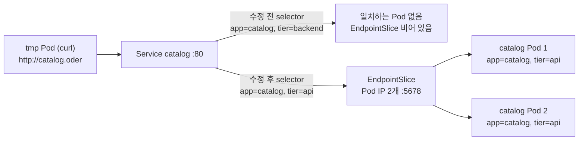

# q15 — Service with a wrong selector · 풀이

← 문제: **[question.md](question.md)**

## 문제 (해석)

**원문**

> Clients in namespace `oder` get no answer from Service `catalog`, although the Pods of Deployment
> `catalog` are running and `Ready`.
>
> 1. Find out why Service `catalog` has no endpoints and fix the **Service** so that it sends traffic
>    to the Pods of Deployment `catalog`. Do not modify the Deployment or its Pods.
> 2. Write the IP addresses listed in the EndpointSlice of Service `catalog`, one per line, to
>    `/opt/course/f15/endpoints.txt`.
> 3. From a temporary Pod using image `curlimages/curl:8.10.1`, request `http://catalog.oder` and
>    write the response body to `/opt/course/f15/response.txt`.

**해석**

`oder` 네임스페이스의 클라이언트가 Service `catalog` 에서 응답을 받지 못한다. Deployment `catalog` 의 Pod 는
실행 중이고 `Ready` 인데도 그렇다.

1. Service `catalog` 에 endpoint 가 없는 이유를 찾아, Deployment `catalog` 의 Pod 로 트래픽을 보내도록
   **Service** 를 고친다. Deployment 와 그 Pod 는 바꾸지 않는다.
2. Service `catalog` 의 EndpointSlice 에 있는 IP 주소를 한 줄에 하나씩 `/opt/course/f15/endpoints.txt` 에 적는다.
3. 이미지 `curlimages/curl:8.10.1` 로 임시 Pod 를 띄워 `http://catalog.oder` 를 요청하고, 응답 본문을
   `/opt/course/f15/response.txt` 에 적는다.

## 모범 풀이

**1) selector 와 Pod 라벨 비교 후 Service 수정**

```bash
kubectl -n oder get endpointslice -l kubernetes.io/service-name=catalog
# NAME            ADDRESSTYPE   PORTS     ENDPOINTS   AGE
# catalog-xxxxx   IPv4          <unset>   <unset>     2m        ← 비어 있음
kubectl -n oder get svc catalog -o jsonpath='{.spec.selector}{"\n"}'
# {"app":"catalog","tier":"backend"}
kubectl -n oder get pods --show-labels
# catalog-...   1/1   Running   ...   app=catalog,pod-template-hash=...,tier=api
kubectl -n oder get pods -l app=catalog,tier=backend       # No resources found ← 원인
```

Service selector 의 **모든** 라벨이 Pod 에 있어야 선택됩니다(AND). `tier=backend` 인 Pod 가 없으니 endpoint 가
0개입니다. Pod 라벨에 맞춰 Service 를 고칩니다.

```bash
kubectl -n oder set selector svc catalog 'app=catalog,tier=api'
# 또는
kubectl -n oder patch svc catalog -p '{"spec":{"selector":{"tier":"api"}}}'
```

`kubectl set selector` 는 selector 를 **통째로 바꾸므로** 유지할 라벨(`app=catalog`)도 함께 적습니다. merge patch 는
준 키만 바꿉니다. selector 를 `pod-template-hash` 까지 넣어 좁히면 다음 롤아웃 때 다시 끊기니 넣지 않습니다.

**2) EndpointSlice 의 IP 기록**

```bash
kubectl -n oder get endpointslice -l kubernetes.io/service-name=catalog \
  -o jsonpath='{range .items[*].endpoints[*]}{.addresses[0]}{"\n"}{end}' > /opt/course/f15/endpoints.txt
cat /opt/course/f15/endpoints.txt
# 10.0.1.41
# 10.0.2.17
kubectl -n oder get pods -l app=catalog -o wide       # Pod IP 와 같은지 대조
```

**3) 클러스터 안에서 호출**

```bash
kubectl -n oder run tmp --rm -i --restart=Never --image=curlimages/curl:8.10.1 -- \
  curl -s http://catalog.oder | grep -v 'deleted' > /opt/course/f15/response.txt
cat /opt/course/f15/response.txt
# catalog
```

`catalog.oder` 는 `<service>.<namespace>` 로, 검색 도메인이 `svc.cluster.local` 을 붙여 줍니다.
`grep -v` 는 `kubectl run --rm` 이 덧붙일 수 있는 `pod "tmp" deleted` 줄을 걸러 냅니다.

### 그림 — selector 가 endpoint 를 정하는 과정



1. EndpointSlice 컨트롤러는 Service selector 의 라벨을 **모두** 가진 Ready Pod 만 EndpointSlice 에 넣습니다.
2. 수정 전에는 `tier=backend` 가 맞는 Pod 가 없어 EndpointSlice 가 비고, 요청이 갈 곳이 없습니다.
3. selector 를 Pod 라벨(`tier=api`)에 맞추면 바로 두 Pod 의 IP 가 들어가고, kube-proxy 가 `:80` → Pod `:5678` 로 보냅니다.

## 검증

```bash
kubectl -n oder get svc catalog -o jsonpath='{.spec.selector}{"\n"}'
# {"app":"catalog","tier":"api"}
kubectl -n oder get endpointslice -l kubernetes.io/service-name=catalog
# catalog-xxxxx   IPv4   5678   10.0.1.41,10.0.2.17   5m
wc -l < /opt/course/f15/endpoints.txt          # 2
cat /opt/course/f15/response.txt               # catalog
kubectl -n oder get deploy catalog -o jsonpath='{.metadata.generation}{"\n"}'   # 1 — Deployment 손대지 않음
```

## 오답 원인 / 배운 점

- **왜 틀렸나**:
- **기억할 것**: endpoint 가 비면 `get svc -o jsonpath='{.spec.selector}'` 와 `get pods --show-labels` 를 나란히 놓고 비교한다.
- **헷갈리는 지점**: `kubectl set selector` 는 selector 전체를 교체합니다. Endpoints API 는 v1.33 부터 deprecated 라 `get ep` 대신 `get endpointslice -l kubernetes.io/service-name=<svc>` 로 확인합니다.

## 참고 문서

- 검색어: `debug services`, `endpointslices`
- https://kubernetes.io/docs/tasks/debug/debug-application/debug-service/
- https://kubernetes.io/docs/concepts/services-networking/endpoint-slices/

---

[↑ 문항 목록](../README.md) · [← 문제로](question.md) · [다음 문제 q16 →](../q16_ingress_fix_port_and_class/question.md)
