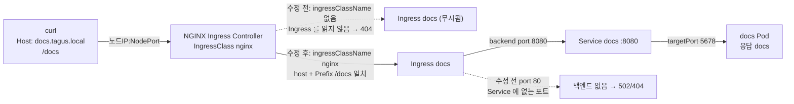

# q16 — Repair a broken Ingress · 풀이

← 문제: **[question.md](question.md)**

## 문제 (해석)

**원문**

> Service `docs` in namespace `tagus` works, but requests for `http://docs.tagus.local/docs` sent
> through the Ingress controller fail. Ingress `docs` was written for this purpose but contains two
> mistakes.
>
> 1. Fix Ingress `docs` in namespace `tagus` so that it is handled by the Ingress controller installed
>    in the cluster and forwards to Service `docs` on the port that this Service exposes. Do not
>    change Service `docs` or Deployment `docs`, and do not create a new Ingress.
> 2. Using `curl` against the Ingress controller's NodePort with the header `Host: docs.tagus.local`,
>    request path `/docs` and write the response body to `/opt/course/f16/response.txt`.

**해석**

`tagus` 네임스페이스의 Service `docs` 는 정상인데, Ingress 컨트롤러를 거친 `http://docs.tagus.local/docs` 요청은
실패한다. 이 용도로 작성한 Ingress `docs` 에 실수가 두 군데 있다.

1. `tagus` 의 Ingress `docs` 를 고쳐, 클러스터에 설치된 Ingress 컨트롤러가 처리하고 Service `docs` 가 노출하는
   포트로 전달하게 한다. Service `docs` 와 Deployment `docs` 는 바꾸지 않고, 새 Ingress 도 만들지 않는다.
2. `Host: docs.tagus.local` 헤더를 붙여 Ingress 컨트롤러의 NodePort 로 경로 `/docs` 를 `curl` 하고, 응답 본문을
   `/opt/course/f16/response.txt` 에 적는다.

## 모범 풀이

**1) 실수 두 개 찾기**

```bash
kubectl get ingressclass
# NAME    CONTROLLER                     PARAMETERS   AGE
# nginx   nginx.org/ingress-controller   <none>       1h
kubectl -n tagus get ingress docs
# NAME   CLASS    HOSTS              ADDRESS   PORTS   AGE
# docs   <none>   docs.tagus.local             80      1m       ← 실수 1: 클래스 없음
kubectl -n tagus describe ingress docs | grep -A3 Rules
#   docs.tagus.local  /docs   docs:80 (<error: service port 80 not found>)  ← 실수 2
kubectl -n tagus get svc docs
# NAME   TYPE        CLUSTER-IP     PORT(S)    AGE
# docs   ClusterIP   10.96.12.34    8080/TCP   1m
```

`ingressClassName` 이 없고 기본 IngressClass 도 없으면 어떤 컨트롤러도 이 Ingress 를 맡지 않습니다(F5 NGINX
Ingress Controller 는 기본값으로 클래스 없는 Ingress 를 무시합니다). 백엔드 포트는 **Service 의 port**(8080)여야
하고, 80 이나 컨테이너 포트 5678 이 아닙니다.

**2) Ingress 수정**

```bash
kubectl -n tagus patch ingress docs --type=json -p='[
  {"op":"add","path":"/spec/ingressClassName","value":"nginx"},
  {"op":"replace","path":"/spec/rules/0/http/paths/0/backend/service/port/number","value":8080}
]'
```

`kubectl -n tagus edit ingress docs` 로 `spec.ingressClassName: nginx` 를 넣고 `number: 80` → `8080` 으로 바꿔도
같습니다. 고친 결과는 다음과 같습니다.

```yaml
spec:
  ingressClassName: nginx
  rules:
  - host: docs.tagus.local
    http:
      paths:
      - path: /docs
        pathType: Prefix
        backend:
          service:
            name: docs
            port:
              number: 8080
```

옛 방식의 `kubernetes.io/ingress.class` 어노테이션은 deprecated 이므로 `spec.ingressClassName` 필드를 씁니다.

**3) NodePort 로 확인**

```bash
NP=$(kubectl -n nginx-ingress get svc nginx-ingress -o jsonpath='{.spec.ports[?(@.name=="http")].nodePort}')
NODE=$(kubectl get nodes -o jsonpath='{.items[0].status.addresses[?(@.type=="InternalIP")].address}')
curl -s -H 'Host: docs.tagus.local' http://$NODE:$NP/docs > /opt/course/f16/response.txt
cat /opt/course/f16/response.txt
# docs
```

컨트롤러가 설정을 다시 읽는 데 몇 초 걸릴 수 있습니다. 404 가 나오면 잠시 뒤 다시 보냅니다.

### 그림 — 고치기 전과 후의 요청 경로



1. 컨트롤러는 자기 클래스(`nginx`)를 가리키는 Ingress 만 읽습니다. 클래스가 비어 있으면 Ingress 가 있어도 설정에 들어가지 않습니다.
2. 클래스를 넣으면 Host `docs.tagus.local` 과 `Prefix /docs` 규칙이 컨트롤러 설정에 들어갑니다.
3. 백엔드 포트는 Service 의 `port` 를 가리켜야 합니다. 80 은 Service 에 없어 갈 곳이 없고, 8080 으로 고치면 Service 가 Pod 의 5678 로 넘깁니다.

## 검증

```bash
kubectl -n tagus get ingress docs
# NAME   CLASS   HOSTS              ADDRESS   PORTS   AGE
# docs   nginx   docs.tagus.local             80      5m
kubectl -n tagus get ingress docs -o jsonpath='{.spec.rules[0].http.paths[0].backend.service.port.number}{"\n"}'
# 8080
cat /opt/course/f16/response.txt                                   # docs
curl -s -o /dev/null -w '%{http_code}\n' -H 'Host: docs.tagus.local' http://$NODE:$NP/docs   # 200
kubectl -n tagus get svc docs -o jsonpath='{.spec.ports[0].port}{"\n"}'                       # 8080 (그대로)
```

## 오답 원인 / 배운 점

- **왜 틀렸나**:
- **기억할 것**: Ingress 가 안 되면 `get ingress` 의 CLASS 열과 `describe ingress` 의 백엔드(`<error: service port ... not found>`)부터 본다.
- **헷갈리는 지점**: `backend.service.port.number` 는 Service port 이지 targetPort 가 아닙니다. Ingress NGINX(kubernetes/ingress-nginx)는 2026-03 에 은퇴했지만 Ingress API 는 GA 그대로이고, 이 실습은 F5 NGINX Ingress Controller(`nginx.org/ingress-controller`)를 씁니다.

## 참고 문서

- 검색어: `ingress`, `ingress class`
- https://kubernetes.io/docs/concepts/services-networking/ingress/
- https://kubernetes.io/docs/concepts/services-networking/ingress/#ingress-class
- https://kubernetes.io/blog/2025/11/11/ingress-nginx-retirement/

---

[↑ 문항 목록](../README.md) · [← 문제로](question.md) · [다음 문제 q17 →](../q17_egress_networkpolicy_dns_backend/question.md)
