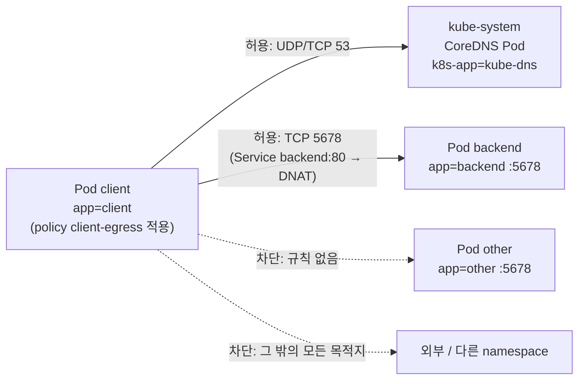

# q17 — Restrict egress to DNS and one backend · 풀이

← 문제: **[question.md](question.md)**

## 문제 (해석)

**원문**

> In namespace `shannon`, Pod `client` must only be able to talk to the backend. Pods `backend` and
> `other` are exposed by Services `backend` and `other` on port `80`.
>
> 1. Create a NetworkPolicy `client-egress` in namespace `shannon` that applies only to Pod `client`
>    and restricts its outgoing traffic to:
>    - DNS (port `53`, UDP and TCP) to the cluster DNS Pods (label `k8s-app=kube-dns`) in namespace
>      `kube-system`, and
>    - the Pods labelled `app=backend`, on the port those Pods listen on.
>
>    Do not restrict incoming traffic.
> 2. From Pod `client`, confirm that `nslookup backend.shannon.svc.cluster.local` and
>    `wget -qO- -T 3 http://backend` succeed, and write the output of the `wget` command to
>    `/opt/course/f17/backend.txt`.
> 3. Confirm that `wget -qO- -T 3 http://other` from Pod `client` now fails.

**해석**

`shannon` 네임스페이스에서 Pod `client` 는 backend 와만 통신할 수 있어야 한다. Pod `backend` 와 `other` 는 각각
Service `backend`, `other` 의 포트 `80` 으로 노출되어 있다.

1. `shannon` 에 Pod `client` 에만 적용되는 NetworkPolicy `client-egress` 를 만들어, 나가는 트래픽을 다음으로 제한한다.
   - `kube-system` 네임스페이스의 클러스터 DNS Pod(라벨 `k8s-app=kube-dns`)로 가는 DNS(포트 `53`, UDP 와 TCP)
   - 라벨 `app=backend` 인 Pod 로, 그 Pod 가 듣는 포트

   들어오는 트래픽은 제한하지 않는다.
2. Pod `client` 에서 `nslookup backend.shannon.svc.cluster.local` 과 `wget -qO- -T 3 http://backend` 가 성공하는지
   확인하고, `wget` 출력을 `/opt/course/f17/backend.txt` 에 적는다.
3. Pod `client` 에서 `wget -qO- -T 3 http://other` 가 이제 실패하는지 확인한다.

## 모범 풀이

**0) 정책에 쓸 라벨과 포트 확인**

```bash
kubectl -n shannon get pods --show-labels
# backend   app=backend
# client    app=client
# other     app=other
kubectl -n shannon get pod backend -o jsonpath='{.spec.containers[0].ports[0].containerPort}{"\n"}'   # 5678
kubectl -n kube-system get pods -l k8s-app=kube-dns
```

**1) NetworkPolicy**

```yaml
apiVersion: networking.k8s.io/v1
kind: NetworkPolicy
metadata:
  name: client-egress
  namespace: shannon
spec:
  podSelector:
    matchLabels:
      app: client
  policyTypes:
  - Egress
  egress:
  - to:                                   # 규칙 1: DNS
    - namespaceSelector:
        matchLabels:
          kubernetes.io/metadata.name: kube-system
      podSelector:                        # 같은 항목 안 → AND
        matchLabels:
          k8s-app: kube-dns
    ports:
    - protocol: UDP
      port: 53
    - protocol: TCP
      port: 53
  - to:                                   # 규칙 2: backend Pod
    - podSelector:
        matchLabels:
          app: backend
    ports:
    - protocol: TCP
      port: 5678                          # Service 포트 80 이 아니라 Pod 포트
```

```bash
kubectl apply -f /tmp/client-egress.yaml     # 위 YAML 을 이 파일로 저장한 뒤
```

- `policyTypes: [Egress]` 만 적었으므로 들어오는 트래픽은 그대로입니다. `Ingress` 를 넣고 규칙을 비우면 ingress 까지 모두 막힙니다.
- `namespaceSelector` 와 `podSelector` 를 **같은 `-` 항목**에 쓰면 "kube-system 의 kube-dns Pod"(AND)이고, 둘을 따로 `-` 로 나누면 "kube-system 의 모든 Pod 또는 shannon 의 kube-dns Pod"(OR)가 됩니다.
- NetworkPolicy 는 kube-proxy 가 Service IP 를 Pod IP 로 바꾼 **뒤의** 패킷을 봅니다. 그래서 포트는 Service 포트 80 이 아니라 Pod 가 듣는 5678 이어야 합니다.

**2) 허용된 경로 확인**

```bash
kubectl -n shannon exec client -- nslookup backend.shannon.svc.cluster.local
# Name:	backend.shannon.svc.cluster.local
# Address: 10.96.x.y
kubectl -n shannon exec client -- wget -qO- -T 3 http://backend > /opt/course/f17/backend.txt
cat /opt/course/f17/backend.txt
# backend
```

**3) 막힌 경로 확인**

```bash
kubectl -n shannon exec client -- wget -qO- -T 3 http://other
# wget: download timed out
# command terminated with exit code 1
```

DNS 는 허용되어 `other` 의 이름은 풀리지만, 패킷이 `other` Pod(5678)로 나가지 못해 타임아웃이 납니다. DNS 규칙을
빼먹으면 `backend` 도 `bad address 'backend'` 로 실패하는데, 이것이 egress 정책에서 가장 흔한 실수입니다.

### 그림 — client 에서 나갈 수 있는 길



1. `podSelector: app=client` 와 `policyTypes: [Egress]` 로, `client` 가 내보내는 패킷은 이제 규칙에 맞는 것만 나갑니다.
2. 첫 번째 규칙은 `kube-system` 의 `k8s-app=kube-dns` Pod 로 가는 53 번 포트(UDP·TCP)만 열어 이름 풀이를 허용합니다.
3. 두 번째 규칙은 `app=backend` Pod 의 5678 번만 엽니다. `http://backend`(Service 80)로 보낸 요청은 DNAT 후 5678 로 나가므로 통과합니다.
4. `other` 는 어느 규칙에도 맞지 않아 패킷이 버려지고, wget 이 응답 없이 타임아웃 됩니다.

## 검증

```bash
kubectl -n shannon get networkpolicy client-egress
kubectl -n shannon describe networkpolicy client-egress | sed -n '/Spec/,$p'
# PodSelector: app=client
# Not affecting ingress traffic
# Allowing egress traffic:
#   To Port: 53/UDP, 53/TCP  To: NamespaceSelector: kubernetes.io/metadata.name=kube-system  PodSelector: k8s-app=kube-dns
#   To Port: 5678/TCP        To: PodSelector: app=backend
# Policy Types: Egress
cat /opt/course/f17/backend.txt                                              # backend
kubectl -n shannon exec client -- wget -qO- -T 3 http://other; echo "exit=$?"  # 타임아웃, exit=1
```

## 오답 원인 / 배운 점

- **왜 틀렸나**:
- **기억할 것**: egress 정책에는 DNS(UDP·TCP 53 → kube-system kube-dns) 규칙을 항상 같이 넣고, 백엔드 포트는 Pod 의 containerPort 로 쓴다.
- **헷갈리는 지점**: `namespaceSelector` 와 `podSelector` 를 한 항목에 쓰면 AND, 두 항목으로 나누면 OR 입니다. NodeLocal DNSCache 를 쓰는 클러스터는 DNS 가 노드의 169.254.20.10 으로 가므로 `ipBlock` 규칙이 추가로 필요합니다.

## 참고 문서

- 검색어: `network policies`, `declare network policy`
- https://kubernetes.io/docs/concepts/services-networking/network-policies/
- https://kubernetes.io/docs/tasks/administer-cluster/declare-network-policy/

---

[↑ 문항 목록](../README.md) · [← 문제로](question.md)
